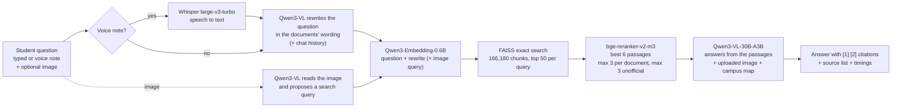
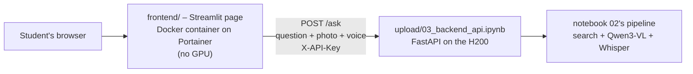

# PU Assist — Multimodal RAG Chatbot for Presidency University

PU Assist answers students' questions about **Presidency University, Bengaluru** — exams and passing rules, attendance,
make-up exams, promotion, fees and EMI, scholarships, programmes and curricula, the academic calendar, LaunchPad,
campus navigation and more — **from the university's own documents, with citations**.

It accepts **text, images** (photos of notices, timetables, assignment questions) and **voice notes**
(English, Hindi, Kannada and ~100 other languages), and runs on the university **Data Lab JupyterHub** GPU (NVIDIA H200).

Instead of fine-tuning, it uses **Retrieval-Augmented Generation (RAG)**: 166,180 cleaned, source-tagged text chunks are
searched for every question and given to a vision-language model (**Qwen3-VL-30B-A3B-Instruct** by default), which writes
the answer and cites `[1] [2]` the sources it used. The knowledge base can be updated any time without retraining.

---

## Contents

1. [Features](#features)
2. [How it works](#how-it-works)
3. [Repository layout](#repository-layout)
4. [Quick start on Data Lab JupyterHub](#quick-start-on-data-lab-jupyterhub)
5. [Web app: backend API + Streamlit frontend](#web-app-backend-api--streamlit-frontend)
6. [Running on another GPU machine](#running-on-another-gpu-machine)
7. [Changing the models](#changing-the-models)
8. [The data](#the-data)
9. [Rebuilding the data from scratch](#rebuilding-the-data-from-scratch)
10. [Raw files not in this repo](#raw-files-not-in-this-repo)
11. [Results so far](#results-so-far)
12. [Limitations and responsible use](#limitations-and-responsible-use)
13. [Roadmap](#roadmap)
14. [Credits](#credits)

---

## Features

| Feature | How |
|---|---|
| Answers from official documents, with citations | RAG over 166k chunks; every fact cited as `[n]` with a clickable source list |
| Says "not found" instead of guessing | System-prompt rules: answer only from sources, never invent rules, fees, dates or names |
| Programme- and batch-aware | Asks for programme/batch when rules differ; prefers the newest regulation (e.g. 2025 over 2019) |
| Image questions | Qwen3-VL reads the uploaded notice/timetable/assignment, transcribes it, then searches for the related rules |
| Voice questions | Whisper large-v3-turbo turns a voice note into text (keeps the spoken language) |
| Campus directions | For "where is …" questions the labeled campus map is given to the model automatically and shown under the answer in the chat page |
| Daytime foot traffic | People counts from two campus videos (when recorded, how busy, most people seen at once) |
| Follow-up questions | Chat history + query rewriting ("and for MBA?" becomes a full search query) |
| Official vs unofficial | Every source is labelled (official website / official document / student photo / teacher recording …) |
| Chat UI in the notebook | `ipywidgets` chat box with **Add image** and **Add voice** buttons (works on the hub without any web proxy) |
| Web app for students | Streamlit page calling a FastAPI backend in notebook 03 – per-student chat history, a GPU queue, an API key, photo upload and microphone recording; opened through a Cloudflare public link, a Gradio share link or a Docker container on Portainer |

---

## How it works



**Offline (once):** crawl website + documents + repository + library + media → extract text → clean & deduplicate →
chunk (each chunk also carries the last 300 characters of the chunk before it, so section headings are not lost) →
embed with Qwen3-Embedding → save the FAISS index (`rag_index/`, rebuilt automatically when the corpus or embedding model changes).

**Per question:**

1. **Listen** – a voice note is transcribed by Whisper. Alone it *is* the question; with a typed question it is extra context (e.g. a recorded announcement).
2. **Understand** – Qwen3-VL rewrites the question in regulation wording (*"pass"* → *"minimum performance criteria, End Term Examination"*) and, for an image, transcribes it and proposes a second search query.
3. **Retrieve** – the original question *and* the rewrites are searched in FAISS; the union of candidates is reranked against the question (so a bad rewrite cannot make results worse).
4. **Answer** – Qwen3-VL gets the 6 best passages (+ the image, + the campus map for directions) and a system prompt with the trust rules below.

---

## Repository layout

```
.
├── README.md
├── requirements.txt
├── upload/                          ← EVERYTHING you upload to JupyterHub (one folder, flat)
│   ├── 01_model_setup.ipynb         one-time setup: libraries, model download, text + image test
│   ├── 02_rag_chatbot.ipynb         the chatbot: index, search, voice, image, chat box, tests
│   ├── 03_backend_api.ipynb         the chatbot as a web API (FastAPI) + public links (Cloudflare / Gradio)
│   ├── pu_corpus.jsonl.gz           166,180 cleaned chunks (47.7 MB) – the knowledge base
│   ├── campus_map.png               labeled campus map (numbered places + legend): read by the model and shown in chat for "where is …" questions
│   └── corpus_stats.json            counts per source
├── frontend/                        the students' web page – Docker image for Data Lab / Portainer
│   ├── app.py                       Streamlit chat page (text, photo, microphone, sources)
│   ├── Dockerfile                   python:3.11-slim image, port 8501, runs as non-root
│   ├── docker-compose.yml           Portainer stack (BACKEND_URL, PU_API_KEY)
│   └── README.md                    build, push/import and deploy steps, troubleshooting
├── data_pipeline/                   how the corpus was collected (scripts + all their outputs)
│   ├── README.md                    original pipeline notes
│   ├── unpack_data.py               restores the big .jsonl files from the gzipped copies
│   ├── crawl_presidency.mjs …       website crawlers (Node.js, no npm packages needed)
│   ├── extract_documents.py …       PDF/Office text extraction, chunking, topic tagging
│   ├── dataset/                     website crawl: pages, chunks, document text, manifests, guides
│   ├── dataset_sources/             repository, library, CSE regulations PDF, campus map, virtual tour,
│   │                                campus photos, video frames/transcripts, student interview audio
│   └── keshavs_input/               original inputs: teacher + student audio, campus map PDF,
│                                    CSE regulations PDF, campus videos re-encoded to 720p
└── tools/                           scripts that turned the pipeline output into upload/pu_corpus.jsonl.gz
    ├── build_upload_bundle.py       merge + clean + dedupe all chunk files → pu_corpus.jsonl.gz
    ├── transcribe_teacher.py        Whisper transcription of the teacher interview
    ├── detect_people.py             RT-DETR person counts on video frames (4 fps)
    ├── fix_rotation.py              re-counts sideways-filmed video blocks upright
    ├── build_media_chunks.py        adds teacher + people-traffic chunks to the corpus
    └── media_outputs/               transcript + per-frame people detections used for the corpus
```

---

## Quick start on Data Lab JupyterHub

Needs a GPU with **≥ 80 GB** memory for the default model (the Data Lab H200 has 143 GB). Smaller GPUs: see
[Changing the models](#changing-the-models).

**One-time setup**

1. Download this repo (**Code → Download ZIP**) and unzip it on your laptop.
2. On JupyterHub, create a folder (e.g. `pu_bot`), open it and **⬆ Upload** every file from the repo's **`upload/`** folder
   (keep them together in one folder — the notebooks look for the data next to themselves).
3. Open **`01_model_setup.ipynb`** and run the cells top to bottom:
   - step 2 installs/upgrades libraries (keeps the hub's CUDA PyTorch 2.9.1, adds the matching torchvision 0.24.1);
   - **after step 2: Kernel → Restart Kernel**, then continue from step 3;
   - step 4 downloads the model to `~/hf_models/` (~62 GB, 5–20 min, only once);
   - steps 7–8 test a text and an image question.
4. **Shut down notebook 01's kernel** (Kernel → Shut Down Kernel) — it holds ~62 GB of GPU memory.

**Every time**

5. Open **`02_rag_chatbot.ipynb`** → **Kernel → Restart Kernel and Run All Cells**.
   - First run builds the search index (~8 min) and installs `av` + downloads Whisper (~1–2 min); later runs load in ~2 min.
   - Step 5 and step 9 print retrieval tests (`Right source in top 6: X/13`).
6. Use the **chat box** at step 16: type a question, optionally **Add image** / **Add voice**, press **Ask**.
   Press **New conversation** to clear the chat history.

> Uploading a new notebook while the old one is open shows *"File Changed"* — click **Revert** (not Overwrite).
> The optional Gradio page (step 17) only works on hubs that have `jupyter-server-proxy`; the Data Lab hub does not.

**Try:**
*"What is the minimum attendance needed to write the end-term exam?"* ·
*"What marks do I need to pass a theory course?"* · *"Can I pay my fees in monthly EMIs?"* ·
*"Where is the Registrar's office?"* · *"How much people traffic is there on campus during the day?"* ·
*"What are the working hours of the Learning and Development department?"* · a voice note · a photo of a notice.

> **The Data Lab hub forgets everything when the server stops** (files, the downloaded model, installed
> libraries). After a restart: upload `upload/` again, run notebook 01 steps 1–4, then notebook 02.

---

## Web app: backend API + Streamlit frontend

Data Lab requires GPU apps to be split into a **backend** (a notebook on Compute, served as an API) and a
**frontend** (a Docker container deployed with Portainer):



**Backend – `upload/03_backend_api.ipynb`.** It does not copy notebook 02's code: it runs 02's setup and pipeline
cells straight from `02_rag_chatbot.ipynb` (skipping its tests and chat box), so prompt or model changes made in 02
apply to the API too. It adds what real users need: a separate chat history per student (`session_id`), a queue so
the GPU answers one question at a time, an API key, and upload limits (image 10 MB, audio 25 MB).

| Endpoint | Input | Output |
|---|---|---|
| `GET /health` | – | `status`, `model`, `chunks`, `busy`, `active_sessions` |
| `POST /ask` | form `question`, `session_id`; files `image`, `audio` (all optional, but a question or voice note is required); header `X-API-Key` | `answer`, `sources` (title, url, kind, cited), `used_map`, `timings`, `session_id`, `heard` |
| `GET /map` | header `X-API-Key` | `campus_map.png` – the chat page shows it under answers with `used_map: true` |
| `POST /reset` | form `session_id`; header `X-API-Key` | forgets that student's history |

Run order on the hub: notebook 01 (steps 1–4) → notebook 02 (builds the index) → **shut down 02's kernel** (two
copies of the model do not fit) → **notebook 03 → Run All**, and keep it running. Step 2 prints the API key,
step 6 tests the API, step 7 prints the machine's addresses for the frontend's `BACKEND_URL`.

**Frontend – `frontend/`.** A Streamlit chat page (chat history, 📎 photo, microphone recorder, clickable sources,
online/busy status, new conversation) configured with two environment variables, `BACKEND_URL` and `PU_API_KEY`.
Build it with `docker build -t pu-assist-frontend:1.0 frontend`, bring the image into Portainer (Docker Hub push,
image import or build in Portainer) and deploy it as a container or with `frontend/docker-compose.yml` –
step by step in [`frontend/README.md`](frontend/README.md).

*Status:* the API runs on the Data Lab H200 and is reachable inside Data Lab's Docker Swarm network at
`http://jupyter-<username>:8000`; the frontend was tested end to end on a laptop and as a Docker container.

### Ways to open the chatbot

The Data Lab hub has no `jupyter-server-proxy`, so a web page started in a notebook cannot be opened directly.
These are the options, from quickest to most official:

| # | Way | Where | Link | Who can open it | Status |
|---|---|---|---|---|---|
| 1 | **Chat box in the notebook** (ipywidgets) | notebook 02, step 16 | none – inside JupyterLab | only you | ✅ works on the hub |
| 2 | **Streamlit page + Cloudflare quick tunnel** | notebook 03, step 9 (`MAKE_PUBLIC_LINK = True`) | `https://….trycloudflare.com` | anyone with the link | ✅ works on the hub (used for a class test) |
| 3 | **Gradio share link** | notebook 03, step 10 (`MAKE_GRADIO_LINK = True`) | `https://….gradio.live` (~1 week) | anyone with the link | tested locally |
| 4 | **Streamlit page as a Docker container on Portainer** | `frontend/` + notebook 03 | Data Lab's address for the container | students via Data Lab | official route; needs Portainer access |
| 5 | Gradio page through the hub's proxy | notebook 02, step 17 | `…/user/<you>/proxy/<port>/` | logged-in hub users | ❌ not on this hub (no `jupyter-server-proxy`) |

**Option 2 – step by step:** run notebooks 01 → 02 → shut down 02's kernel → notebook 03 *Run All*; then in step 9
set `MAKE_PUBLIC_LINK = True` and run that cell. It downloads `frontend/app.py` from this repo, installs Streamlit,
downloads Cloudflare's `cloudflared`, starts the page next to the API and prints the public link. Stop it with
`tunnel_proc.terminate(); streamlit_proc.terminate()`.

**Option 3 – step by step:** same notebooks, then in step 10 set `MAKE_GRADIO_LINK = True` and run that cell; it prints
a `gradio.live` link. Stop it with `gradio_demo.close()`.

Notes for options 2 and 3: the link is public (set `APP_PASSWORD` / `GRADIO_PASSWORD` to require a password), traffic
passes through Cloudflare's / Gradio's servers (check that Data Lab allows it), the link dies when notebook 03's kernel
or the hub server stops, and one GPU answers one question at a time, so a whole class waits in a queue.

---

## Running on another GPU machine

Any Linux/Windows machine with an NVIDIA GPU and Python 3.10+:

```bash
pip install -r requirements.txt
```

Install PyTorch for your CUDA version from <https://pytorch.org> first (and a matching `torchvision`), then open
`upload/02_rag_chatbot.ipynb` in Jupyter from inside the `upload/` folder. Pick a model that fits your GPU (next section)
by changing `MODEL_ID` in step 1; the notebook downloads it at step 6 the first time.

---

## Changing the models

All model choices are settings in **step 1 of `02_rag_chatbot.ipynb`** (and `MODEL_ID` in step 3 of `01_model_setup.ipynb`).
The vision-language model is loaded with Transformers' generic `AutoModelForImageTextToText` and `dtype="auto"`, so
switching is a one-line change:

```python
MODEL_ID = "Qwen/Qwen3-VL-8B-Instruct"      # instead of "Qwen/Qwen3-VL-30B-A3B-Instruct"
```

Run the notebook again — step 6 downloads the new model to `~/hf_models/<name>` the first time.

### Vision-language model (`MODEL_ID`)

GPU memory is for the weights only; add ~5–10 GB for the search models, Whisper and long prompts.

| Model | Type | Weights in GPU memory | Fits the 143 GB H200? | Notes |
|---|---|---|---|---|
| **`Qwen/Qwen3-VL-30B-A3B-Instruct`** (default) | MoE, 31B total / ~3B active | **62.1 GB (measured)** | ✅ | Best quality/speed balance; tested end to end |
| `Qwen/Qwen3-VL-30B-A3B-Instruct-FP8` | same, FP8 weights | ~32 GB | ✅ | Half the memory; needs a Hopper/Ada GPU (H100/H200/L40S) |
| `Qwen/Qwen3-VL-32B-Instruct` | dense 33B | ~67 GB | ✅ | Slower than 30B-A3B (all parameters active) |
| `Qwen/Qwen3-VL-8B-Instruct` | dense 8.8B | ~18 GB | ✅ | Good choice for 24–40 GB GPUs |
| `Qwen/Qwen3-VL-8B-Instruct-FP8` | dense 8.8B, FP8 | ~10 GB | ✅ | Hopper/Ada GPUs |
| `Qwen/Qwen3-VL-4B-Instruct` | dense 4.4B | ~9 GB | ✅ | 16 GB GPUs |
| `Qwen/Qwen3-VL-2B-Instruct` | dense 2.1B | ~5 GB | ✅ | Fast tests, weakest answers |
| `Qwen/Qwen2.5-VL-7B-Instruct` | previous generation | ~17 GB | ✅ | Works with the same code |
| `Qwen/Qwen3-VL-235B-A22B-Instruct` | MoE, 235B | ~470 GB | ❌ | Needs several GPUs; not supported by these notebooks |

*Tested:* Qwen3-VL-30B-A3B on the H200; the generic loader was additionally checked to resolve Qwen3-VL (dense and MoE) and
Qwen2.5-VL. Other vision-language models (Llama-3.2-Vision, Phi-3.5-vision, …) may need prompt/processor changes and are
untested. Llama-3.2-90B-Vision (≈180 GB in bf16) does not fit on one H200.

### Embedding model (`EMBED_MODEL`, `QUERY_PROMPT`)

Changing it **rebuilds the index automatically** (bigger models take longer than the 8 minutes of the default).

| Model | Vector size | Query prefix (`QUERY_PROMPT`) | Notes |
|---|---|---|---|
| **`Qwen/Qwen3-Embedding-0.6B`** (default) | 1024 | keep the default `Instruct: …\nQuery:` | Multilingual, ~350 chunks/s on the H200 |
| `Qwen/Qwen3-Embedding-4B` | 2560 | same | Better retrieval, several times slower to index |
| `Qwen/Qwen3-Embedding-8B` | 4096 | same | Best Qwen embedder, slowest |
| `BAAI/bge-m3` | 1024 | set `QUERY_PROMPT = ""` | Strong multilingual baseline |
| `intfloat/multilingual-e5-large-instruct` | 1024 | `Instruct: <task>\nQuery: ` (same style as default) | |

### Reranker (`RERANK_MODEL`)

Any sentence-transformers **cross-encoder** works: **`BAAI/bge-reranker-v2-m3`** (default, multilingual),
`BAAI/bge-reranker-large` (English/Chinese), `cross-encoder/ms-marco-MiniLM-L6-v2` (English only, very fast).
LLM-based rerankers such as `BAAI/bge-reranker-v2-gemma` are not drop-in replacements.

### Speech-to-text (`ASR_MODEL`)

**`openai/whisper-large-v3-turbo`** (default, 809M, fast and accurate) · `openai/whisper-large-v3` (1.5B, slightly more
accurate, slower) · `openai/whisper-medium` (764M) · `openai/whisper-small` (242M, fastest, more mistakes).

### Retrieval settings

`CANDIDATES` (FAISS hits per query, default 50), `TOP_K` (passages given to the model, 6), `MAX_PER_SOURCE` (3),
`MAX_UNOFFICIAL` (3), `CONTEXT_CHARS` (previous-chunk context, 300; changing it rebuilds the index).
The bot's behaviour is the `SYSTEM_PROMPT` in step 8; query rewriting is `REWRITE_PROMPT`.

---

## The data

### Sources

| Source | What was collected |
|---|---|
| Official website (presidencyuniversity.in) | 4,333 HTML pages from the sitemap + links found on pages |
| Linked official documents | 2,522 PDFs/Office files downloaded (≤ 50 MB each); 758 had no extractable text (scanned) |
| B.Tech CSE Programme Regulations & Curriculum 2023–27 | 277-page PDF → 660 chunks with page numbers |
| DSpace academic repository | 14,145 item records (question papers, make-up exam papers) — metadata only |
| Koha library catalogue | public pages + 26 catalogue records (personal data removed by `sanitize_catalog_pii.py`) |
| Campus map (PDF) | text + a rendered page image (`campus_map.png`) given to the model |
| 360° virtual campus tour (third-party) | 166 scene/hotspot labels, 142 thumbnails |
| Campus photos | 80 photos (compressed) with reviewed captions |
| Campus videos V1 (51 s) and V2 (142 s) | 96 sampled frames with scene captions, 40 speech-transcript segments, people counts at 4 fps |
| Student interview (audio, ~4 min) | 68 timestamped Whisper transcript segments |
| Teacher interview, Learning & Development dept. (audio, 2 min 21 s) | transcript + summary (4 chunks) |
| External (Wikipedia, UGC directory) | 8 chunks, labelled as not university policy |

### The corpus (`upload/pu_corpus.jsonl.gz`)

231,591 records were read from 12 chunk files; **65,361 duplicate texts** (menus/footers repeated on every page) and 78
too-short chunks were removed, broken characters cleaned, and mirrored text in the campus-map PDF un-mirrored.

| `source_class` | Chunks |
|---|---|
| official_document | 140,273 |
| repository_metadata | 14,145 |
| official_website | 10,610 |
| official_program_regulation | 660 |
| user_video (scene captions, speech, people counts) | 160 |
| campus_tour | 139 |
| user_photo | 80 |
| user_interview | 68 |
| library_catalog | 26 |
| external | 8 |
| campus_map | 7 |
| teacher_audio | 4 |
| **Total** | **166,180** |

One JSON object per line:

```json
{"id": "doc-a52a7f99c3744a316b4d5a4e-35",
 "text": "…A student must obtain a minimum of 30% of the total marks/weightage assigned to the End Term Examinations…",
 "title": "Academic Regulation 2025",
 "source_class": "official_document", "source_type": "document",
 "url": "https://presidencyuniversity.in/uploads/images/68903c797f1721754283129.pdf",
 "page_url": "https://presidencyuniversity.in/academic-regulations/",
 "topics": ["examinations_pass_makeup_year_back"], "unverified": false}
```

Other fields when relevant: `page`, `local_path`, `category`, `start_seconds`/`end_seconds` (audio/video), `n_copies`.

> **Data notice.** The crawl contains text exactly as published on the university's public website and documents,
> including contact details printed there. Media transcripts are automatic and unverified. If you are listed and want
> something removed, please open an issue.

---

## Rebuilding the data from scratch

Requirements: **Node.js 18+** (crawlers use only built-in modules), **Python 3.10+** with `pypdf`, `pillow`, `numpy`,
`transformers`, `sentence-transformers`, `av`, and **ffmpeg** on the PATH.

```bash
python data_pipeline/unpack_data.py          # restore the big .jsonl files from the gzipped copies
```

Website crawl and documents (run inside `data_pipeline/`, in this order):

```bash
node crawl_presidency.mjs          # sitemap pages + linked documents -> dataset/
python find_unindexed_links.py
node crawl_unindexed.mjs           # internal pages missing from the sitemap
python extract_documents.py        # PDF/Office text -> documents_text.jsonl, document_chunks.jsonl
python build_link_graph.py
python normalize_chunk_ids.py
python build_focused_dataset.py    # topic-tagged focused_chunks.jsonl
python finalize_dataset.py
```

Other sources: `crawl_jspui.mjs`, `collect_oai_sets.mjs`, `summarize_jspui.py` (repository) ·
`dataset_sources/library_site/*.mjs|py` (library) · `scrape_external.mjs` · `scrape_virtual_tour.mjs` ·
`extract_uploaded_pdf.py` · `extract_campus_map.py` · `dataset_sources/user_media/*.py` (photo captions, video frames,
transcripts — put the original videos in `data_pipeline/keshavs_input/` first).

Corpus for the chatbot (from the repo root):

```bash
python tools/build_upload_bundle.py data_pipeline upload            # merge, clean, dedupe -> upload/pu_corpus.jsonl.gz
python tools/transcribe_teacher.py data_pipeline/keshavs_input/Teacher.m4a tools/media_outputs/teacher_transcript.json
# people counts: 4 frames/s at 1280 px, detect, fix sideways blocks
ffmpeg -i data_pipeline/keshavs_input/V1_720p.mp4 -vf "fps=4,scale=1280:-2" -q:v 3 tools/media_outputs/frames/V1/%05d.jpg
ffmpeg -i data_pipeline/keshavs_input/V2_720p.mp4 -vf "fps=4,scale=1280:-2" -q:v 3 tools/media_outputs/frames/V2/%05d.jpg
python tools/detect_people.py tools/media_outputs/frames tools/media_outputs/people
python tools/fix_rotation.py tools/media_outputs
python tools/build_media_chunks.py tools/media_outputs upload       # adds teacher + people-traffic chunks
```

`tools/media_outputs/` already contains the transcript and the per-frame detections used for the published corpus, so
the last command can be re-run without the detection steps.

---

## Raw files not in this repo

GitHub rejects files over 100 MB and large repositories, so these are excluded (their lists are in the repo):

| Excluded | Size | Where to get it |
|---|---|---|
| `data_pipeline/dataset/documents/` – 2,522 downloaded PDFs/Office files | ~3.5 GB | Every file's source URL and local name is in `data_pipeline/dataset/documents_manifest.jsonl`; `node crawl_presidency.mjs` downloads them again. Their extracted text **is** included (`documents_text.jsonl.gz`, `document_chunks.jsonl.gz`). |
| Original 4K campus videos `V1.mp4`, `V2.mp4` (HEVC) | 306 MB + 854 MB | Included instead as **720p H.264 re-encodes** in `data_pipeline/keshavs_input/` (V1_720p.mp4, V2_720p.mp4) |
| 1080p video copies (`dataset_sources/user_media/compressed_videos/`) | 641 MB | Recreate with `dataset_sources/user_media/process_videos.py` from the originals |
| Original full-resolution campus photos | ~3 GB | Compressed copies (≤ 3072 px) are included in `dataset_sources/user_media/compressed/` |

Large text files are stored gzipped (`pages.jsonl` and `focused_chunks.jsonl` also split into parts);
`python data_pipeline/unpack_data.py` restores them byte-for-byte.

---

## Results so far

Measured on the Data Lab H200 (NVIDIA H200 NVL, 143 GB):

| Metric | Result |
|---|---|
| Model load (Qwen3-VL-30B-A3B, bf16) | 52 s, 62.1 GB GPU memory |
| Index build (~166k chunks, one time) | 7.6 min (~350 chunks/s) |
| Search per question (embed + FAISS + rerank) | ~0.3 s |
| Retrieval, first version (right source in top 6, 10 test questions) | 8 / 10 |
| Retrieval with chunk context + query rewriting (13 test questions) | *to be filled from notebook step 9* |

Diagnosing the misses showed the weak link was the vector search, not the reranker: for *"What marks do I need to pass a
theory course?"* the correct chunk ranked **#127** with plain search, **#24** with previous-chunk context and **#1** with
query rewriting — hence both fixes.

People counts (automatic, RT-DETR at 4 fps; recorded Thursday 29 Oct 2026, ~11:24–11:28 AM IST):

| Video | Most people visible at once | Average visible | Time with people in view | Foot traffic |
|---|---|---|---|---|
| V1 (51 s, café/shop area) | 12 (at 0:47) | 4.0 | 90 % | moderate |
| V2 (142 s, paths and sports ground) | 15 (at 1:45) | 4.6 | 84 % | moderate |

The camera holder's finger (a false "person") was filtered out, and sideways-filmed parts were re-counted upright.
No total of *different* people is given — a moving phone camera cannot count that reliably.

---

## Limitations and responsible use

- **Only as current as the crawl.** Fees, timetables, calendars and notices change — the bot tells students to confirm
  with the latest official notice. Re-run the crawl and rebuild the corpus to refresh.
- **Batch- and programme-specific rules.** The CSE 2023–27 regulations apply only to that batch; the bot asks for
  programme and batch when it matters.
- **Unofficial sources are labelled.** Student photos/videos/interviews, the teacher recording and external sites are
  marked unofficial; transcripts are automatic and may contain errors.
- **758 scanned PDFs** have no text yet (OCR is on the roadmap).
- **People counts are a snapshot** of a few minutes on one weekday morning, not traffic at all times.
- **Not an official university service.** Students should verify important decisions with the relevant office.

---

## Roadmap

- **Deployment on Data Lab:** the backend runs on the H200 and the Streamlit page is live through a Cloudflare
  quick tunnel; next is the official Portainer container (`frontend/`, needs Portainer access) and a persistent
  folder for the model and index (the hub forgets everything when the server stops).
- Faster serving with vLLM (~2–5 s per answer).
- Hybrid keyword + vector search for course codes and regulation numbers.
- OCR for the 758 scanned PDFs; scheduled re-crawls.
- Larger evaluation set (100+ questions) and answer-quality scoring.

---

## Credits

Built by B.Tech students of Presidency University, Bengaluru, on the university's Data Lab JupyterHub.
Models: Qwen3-VL and Qwen3-Embedding (Alibaba Qwen, Apache-2.0), bge-reranker-v2-m3 (BAAI, Apache-2.0),
Whisper (OpenAI), RT-DETR (PekingU, Apache-2.0). University content belongs to Presidency University.

No open-source licence has been chosen for this repository yet.
